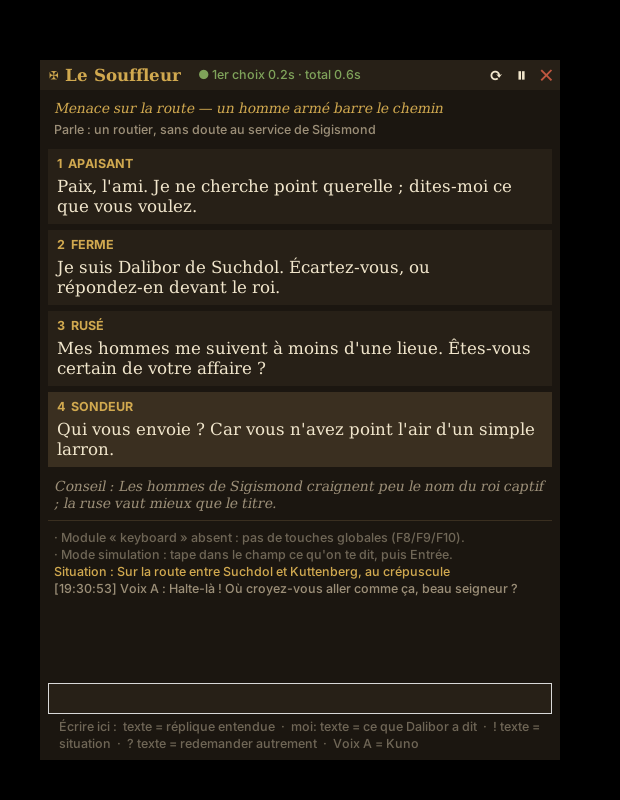

# ✠ Le Souffleur

Comme le souffleur au théâtre : il **écoute** ce qu'on dit à ton personnage dans le chat vocal du jeu, **regarde ton écran** comme s'il était à ta place, et te **propose des répliques d'époque** adaptées à ce qui se passe, dans une petite fenêtre posée par-dessus le jeu.

Fait pour **Dalibor Medved, seigneur de Suchdol**, en **Bohême, 1403** (mod multijoueur de *Kingdom Come: Deliverance II*), mais **réutilisable par n'importe quel joueur** : une fiche de personnage et un guide d'univers suffisent (voir [Pour les admins](#pour-les-admins--réutiliser-le-souffleur)).



## Gratuit ou payant : à toi de choisir

Le Souffleur a deux « cerveaux » au choix (`moteur` dans `config.toml`) :

| | **IA locale** (par défaut) | **Claude** |
|---|---|---|
| Prix | **Gratuit** | Payant à l'usage, quelques euros par soirée |
| Où ça tourne | Sur ton PC (Ollama), rien ne sort de ta machine | Chez Anthropic (Internet) |
| Qualité du français d'époque et du jugement | Bonne | Excellente |
| Ce qu'il faut | Une carte graphique avec assez de mémoire pour le jeu **et** l'IA | Une clé API avec du crédit |

La voix (Whisper) et la capture de l'écran sont **toujours gratuites** et restent sur ton PC.

Pour essayer Claude sans rien changer : `lancer.bat --claude`. Pour revenir au gratuit : `lancer.bat --local`.

## Comment ça marche

```
Chat vocal du jeu ──► capture du son du PC ──► découpe en répliques ──► Whisper (sur ta carte graphique)
Ton micro ────────────► (ce que Dalibor répond) ┘                               │
Écran du jeu ──► filmé en continu (2 images/s, en mémoire vive) ──────────────┤
             ├─► images « début de la phrase » + « maintenant » ───────────────┤
             └─► observateur : lieu, heure, personnes, tension, changements ───┤
                                                                               ▼
     Fenêtre par-dessus le jeu ◄── 3 à 6 répliques (en flux) ◄── l'IA (fiche + guide d'univers + mémoire + images)
```

1. Il écoute **le son qui sort de ton PC**, donc le chat vocal du jeu. Il écoute aussi **ton micro**, pour savoir ce que Dalibor a répondu.
2. Dès que ton interlocuteur marque **0,3 seconde** de silence, sa phrase est transcrite **sur ton PC** (Whisper, sur la carte graphique) et les répliques sont aussitôt demandées. S'il reprend la parole, la phrase est **complétée** (↳ dans le fil) et les répliques refaites.
3. L'IA propose **4 répliques** de tons différents, adaptées à la scène : marchand, menace, ennemi, clerc, supérieur ou paysan. Les choix apparaissent **un par un**, au fur et à mesure qu'ils sont écrits : tu peux lire le premier pendant que les autres arrivent.
4. **Il voit ce que tu vois, en continu.** Ton écran de jeu est filmé en permanence (2 images par seconde, en haute définition, gardées environ 30 secondes en mémoire vive et jamais sur le disque). Pour chaque réplique, l'IA reçoit **l'écran du moment où l'on a commencé à te parler** et **l'écran actuel** s'il a changé : il voit donc aussi ce qui s'est passé pendant la phrase (quelqu'un qui dégaine, s'approche, s'en va). Il voit qui est en face (rang d'après la mise, arme tirée ou non, nombre de gens, gardes, blasons), où tu es (taverne, route, château…), l'heure, et ton état si l'interface le montre. Il juge alors le ton juste : on ne répond pas pareil à un marchand derrière son étal et à trois hommes armés sur une route au crépuscule. Ce qu'il a remarqué s'affiche sous la ligne « Parle » (👁).
5. **Un observateur** suit la scène en continu. Il fait décrire l'écran dès qu'il change (au plus toutes les 15 secondes), **tout de suite** si l'image bascule brutalement (nouveau lieu, combat, chargement), et au moins toutes les minutes. Il tient à jour la scène (bande 👁 en haut de la fenêtre), garde la **chronologie** des dernières scènes pour l'IA, et note dans le fil les changements importants, par exemple « (À l'écran : trois hommes armés barrent la route) ». Il s'aide aussi des derniers échanges pour reconnaître qui est qui.
6. Une **chronique** tourne en arrière-plan. Elle retient les personnes rencontrées, les promesses, les dettes et les menaces, et sert de mémoire d'une session à l'autre (fichier `memoire/<personnage>/registre.json`).
7. **Démarrage à chaud** : dès le lancement, les consignes et les fiches sont préchargées (sur la carte graphique avec l'IA locale, dans le cache de Claude sinon). La toute première réplique part ainsi aussi vite que les suivantes. Le délai réel, mesuré depuis la fin de la phrase entendue, s'affiche en haut de la fenêtre.

## Installation (Windows)

1. Installe **Python 3.12** depuis [python.org](https://www.python.org/downloads/) en cochant **« Add python.exe to PATH »**.
2. Double-clique sur **`lancer.bat`**. La première fois, il installe tout tout seul (comptes 10 à 20 minutes selon ta connexion) :
   - les modules Python ;
   - **Ollama**, le programme gratuit qui fait tourner l'IA sur ton PC (si Windows refuse, `lancer.bat` ouvre la page [ollama.com/download](https://ollama.com/download) : installe-le, puis relance) ;
   - le modèle d'IA, **choisi automatiquement** selon la mémoire de ta carte graphique (de 3 à 15 Go à télécharger), et le modèle de transcription (environ 1,6 Go). Leur téléchargement s'affiche dans la fenêtre.
3. C'est tout : **aucun compte, aucune clé, aucun paiement**.

**Seulement si tu choisis Claude** (`moteur = "claude"`) : crée une clé API sur [console.anthropic.com](https://console.anthropic.com) et achète un peu de crédit. Au lancement, `lancer.bat` ouvre le fichier `.env` : colles-y ta clé à la place de `sk-ant-...`. Tu peux fixer une limite de dépense mensuelle dans la console.

> **Important** : mets le jeu en mode **« Fenêtré sans bordure »** (Borderless), sinon la fenêtre du Souffleur ne peut pas s'afficher par-dessus le jeu en plein écran exclusif.

### Essayer sans le jeu

`lancer.bat --simulation` ouvre la fenêtre sans écouter le son. Tape une réplique, par exemple *« Halte-là ! Qui va là ? »*, puis appuie sur Entrée.

## Utilisation en jeu

| Touche | Effet |
|---|---|
| **F8** | Afficher ou cacher la fenêtre |
| **F9** | Nouvelles répliques pour la même réplique entendue |
| **F10** | Pause ou reprise de l'écoute (pendant une scène hors RP, une pause, une vidéo…) |

- **Clic sur une réplique** : elle est copiée dans le presse-papiers.
- **La fenêtre se déplace** en la tirant par sa barre de titre.

Le **champ en bas** de la fenêtre sert à guider l'outil :

| Tu écris | Effet |
|---|---|
| `! Taverne de Kuttenberg, je cherche un forgeron` | Note la **situation** : l'IA en tient compte pour toute la scène |
| `? plus menaçant` / `? en latin` / `? refuse poliment` | Redemande des répliques **dans un autre sens** |
| `Voix A = Kuno le forgeron` | Donne un **nom** à une voix reconnue |
| `moi: Je vous en sais gré, messire.` | Note ce que **Dalibor** a dit (si le micro n'est pas écouté) |
| n'importe quel autre texte | Ajoute une réplique **entendue**, par exemple quand la transcription a raté un mot |

## Personnaliser

- **`donnees/personnages/dalibor.md`** : la fiche de Dalibor. **Complète-la** avec sa famille, ses armoiries, ses hommes, ses secrets et ce qui se passe dans ton RP. Plus elle est riche, plus les répliques te ressembleront. L'outil ne s'invente jamais de faits importants qui n'y figurent pas.
- **`donnees/univers/boheme_1403.md`** : le guide historique, avec la situation politique, les formules de politesse, la monnaie, la liste d'anachronismes interdits, le style de langue et les scènes typiques. Si ton serveur a son propre lore, ajoute-le ici : c'est le serveur qui a raison.
- **`config.toml`** : le modèle, la vivacité, le nombre de choix et les touches. Les réglages utiles :
  - `anticipation_ms` (300) : le silence après lequel les répliques sont déjà demandées. `silence_fin_ms` (700) : au-delà, la phrase est close pour de bon. Si l'outil complète trop souvent des phrases (↳), monte `anticipation_ms` à 400.
  - `sensibilite` : monte-la (à 4 ou 5) si la musique ou l'ambiance du jeu déclenchent l'écoute.
  - `modele = "claude-haiku-5-5"` : beaucoup plus rapide et bien moins cher, mais un style moins fin. `rapide = true` garde Opus mais en plus rapide, pour un prix doublé.

## Écouter seulement le chat vocal (conseillé)

Par défaut, l'outil écoute **tout** le son du PC : la voix des autres joueurs, mais aussi les PNJ et la musique. Pour qu'il n'entende que les joueurs :

- **Si le mod permet de choisir la sortie du chat vocal** : installe [VB-CABLE](https://vb-audio.com/Cable/) (gratuit), envoie le chat vocal vers « CABLE Input », active « Écouter ce périphérique » dans les propriétés Windows de « CABLE Output » pour l'entendre toi aussi, puis mets `sortie = "CABLE"` dans `config.toml`.
- **Sinon** : baisse la musique et les voix des PNJ dans les options du jeu, et monte `sensibilite`.

`lancer.bat --peripheriques` affiche la liste des périphériques audio.

## Bon à savoir

- **Choisir le modèle local** (`[local] modele` dans `config.toml`) : par défaut (`"auto"`), le Souffleur mesure ta carte graphique NVIDIA, laisse 9 Go au jeu (`reserve_jeu_go`) et 2 Go à la transcription, puis prend le meilleur modèle qui tient dans le reste. Le choix s'affiche au démarrage. Si le jeu saccade, monte `reserve_jeu_go` ; si tu joues en qualité moyenne, baisse-la pour avoir un modèle plus fin. Tu peux aussi imposer un modèle (`gemma3:4b`, `gemma3:12b`, `mistral-small3.1`, `gemma3:27b`). Avec l'IA locale, l'observateur s'efface quand une réplique est en cours, pour que la carte graphique serve d'abord aux répliques.
- **Coût avec Claude seulement** (estimations, avec Opus et des images en 1920 px) :
  - chaque série de répliques coûte environ 3 à 4 centimes, une ou deux images comprises ;
  - l'observateur coûte environ 2 centimes par regard, soit entre 1,5 € de l'heure (scène calme : un regard toutes les 45 s) et 9 € de l'heure au pire (scène qui change sans cesse : un regard toutes les 8 s).

  Avec Claude, une soirée animée revient donc à quelques euros de l'heure (avec l'IA locale : rien). Pour réduire la note, dans `[vision]` : `intervalle_min_s = 20`, `largeur_max = 1280` (environ deux fois moins de jetons par image), ou `modele_observateur = "claude-haiku-5-5"` (de très loin le levier le plus fort). La chronique ne s'exécute que toutes les 8 lignes.
- **Reconnaissance des voix** : elle est approximative. Elle distingue bien des voix différentes, moins bien des voix proches. Nomme les voix (`Voix A = …`) ; l'IA devine aussi qui parle d'après le contexte.
- **Vie privée** : avec l'IA locale, **rien ne sort de ton PC**. Avec Claude, le son reste sur ton PC, mais le **texte** transcrit et les images choisies (réplique, observateur) sont envoyés à Claude. Dans les deux cas, le film de l'écran reste **en mémoire vive** et rien n'est enregistré sur le disque. L'outil capture **uniquement la fenêtre du jeu** quand il la trouve (titre contenant « Kingdom Come ») ; sinon, il prend l'écran entier : pense alors à ne pas laisser de fenêtre privée par-dessus. La fenêtre du Souffleur, elle, est invisible aux captures (Windows 10 version 2004 ou plus récent). Les transcriptions de chaque session sont gardées dans `memoire/sessions/`.
- **Il regarde, il ne joue pas** : l'outil n'envoie jamais de touche ni de clic au jeu. C'est toi qui parles et qui agis.
- **Couper la vue** : `active = false` dans la section `[vision]` de `config.toml`. Pour garder les images avec les répliques sans l'observateur continu : `observateur = false`. F10 met en pause l'écoute, le film et l'observateur.
- **Carte graphique** : la transcription fonctionne au mieux avec une carte NVIDIA. Sans elle, l'outil bascule tout seul sur le processeur, en plus lent.

## Pour les admins : réutiliser le Souffleur

L'outil n'est pas propre à Dalibor : tout ce qui concerne le personnage et l'univers est dans deux fichiers.

1. **Un nouveau personnage** : copie `donnees/personnages/_modele.md` sous un nouveau nom (par exemple `jan.md`) et remplis-le. L'en-tête entre les `---` donne le nom affiché, le nom complet et les noms propres à bien transcrire.
2. **Un autre univers** (un autre serveur, une autre époque) : copie `donnees/univers/boheme_1403.md`. Change le `cadre` de l'en-tête, puis le contenu : situation, manières de parler, anachronismes, style de langue et scènes typiques.
3. **Lancement** : `lancer.bat --personnage jan` (ou `--univers autre_guide`), ou bien règle la section `[jeu]` de `config.toml`.

Chaque personnage a sa propre mémoire (`memoire/<personnage>/`), et plusieurs joueurs peuvent partager le même guide d'univers. Le dossier `roleplay/` se copie tel quel : il ne dépend pas du reste du dépôt.

## Pour les curieux (structure)

```
souffleur/
  audio.py          capture WASAPI (son du PC + micro) et découpe en répliques
  transcription.py  Whisper local (faster-whisper)
  voix.py           reconnaissance approximative de qui parle
  vision.py         film continu de la fenêtre du jeu, observateur
  profil.py         fiches de personnage et guides d'univers interchangeables
  moteurs.py        les deux cerveaux : IA locale (Ollama, gratuite) ou Claude (payant)
  conseiller.py     répliques en flux, chronique, description de la scène
  prompts.py        consignes données à l'IA (gabarits remplis par le profil)
  memoire.py        fil de la conversation, registre des personnes et des faits
  interface.py      fenêtre par-dessus le jeu
  app.py            assemble le tout
tests/              tests sans matériel :  python -m pytest tests
```
